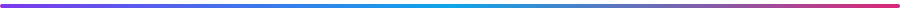
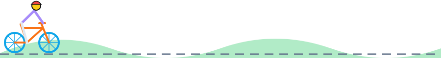
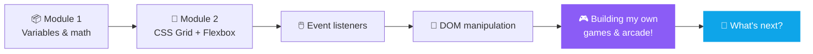
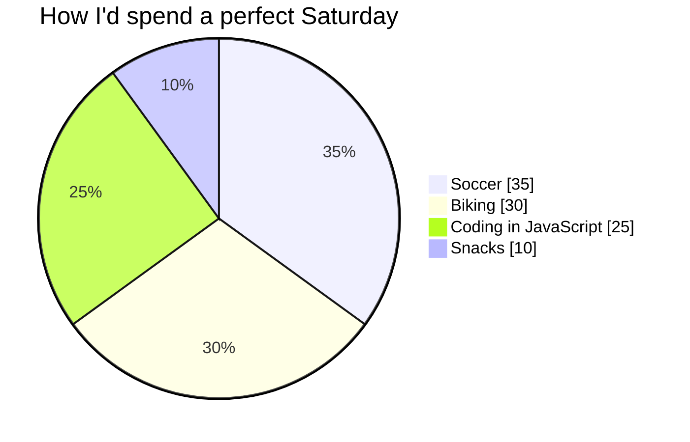

<p align="center">
  <a href="https://bedonjonathan.github.io/BedonJonathan/">
    
  </a>
</p>

<p align="center">
  <a href="https://bedonjonathan.github.io/BedonJonathan/"></a>
  <a href="https://bedonjonathan.github.io/BedonJonathan/#penalty"></a>
  <a href="https://bedonjonathan.github.io/BedonJonathan/#bike"></a>
  <a href="https://bedonjonathan.github.io/BedonJonathan/#quiz"></a>
</p>



## 🙋‍♂️ About me

```javascript
const jonathan = {
  greeting: ["Hola!", "Hello!"],
  askMeAbout: ["⚽ Soccer", "🚴 Biking", "🟨 JavaScript"],
  currentlyLearning: ["CSS Grid + Flexbox", "Event listeners", "DOM manipulation"],
  favoriteKey: "←→←→",          // try the Bike Sprint and you'll see why
  motto: "Keep the ball moving and the wheels turning.",
};

console.log(`Thanks for stopping by! 👋`);
```

<p align="center">
  
</p>

## 🕹️ Choose your adventure

Click a box to open it. Some of them have more boxes inside 👀

<details>
<summary><b>⚽ I'm here for the soccer</b></summary>

<br>

You step up to the penalty spot. The keeper is bouncing on the line. Where do you shoot?

<details>
<summary>↖️ Top corner</summary>

> **GOOOOAL!** 🎉 Top bins, the keeper never had a chance.
> Think you can do it five times in a row? **[Take the penalty shootout →](https://bedonjonathan.github.io/BedonJonathan/#penalty)**

</details>

<details>
<summary>⬇️ Low and hard down the middle</summary>

> The keeper dives left… and the ball goes straight where they were standing. **GOAL!** 😎
> Ice in the veins. **[Prove it in the real shootout →](https://bedonjonathan.github.io/BedonJonathan/#penalty)**

</details>

<details>
<summary>🌈 Try a fancy chip</summary>

> The keeper doesn't move. The ball floats gently… right into their hands. 🧤😬
> Redemption is one click away: **[Try again →](https://bedonjonathan.github.io/BedonJonathan/#penalty)**

</details>

</details>

<details>
<summary><b>🚴 I'm here for the bikes</b></summary>

<br>

You reach the bottom of a huge hill. Your legs are tired. What do you do?

<details>
<summary>⛰️ Climb it!</summary>

> Every pedal stroke burns, but the view at the top is worth it. 🌄 Then comes the downhill. **Wheeeee!**
> Want to race my ghost? **[Start the bike sprint →](https://bedonjonathan.github.io/BedonJonathan/#bike)**

</details>

<details>
<summary>🍦 Stop for ice cream first</summary>

> Honestly? The smartest choice on this page. Fuel is important. 🍦
> Now you're ready: **[Race the bike sprint →](https://bedonjonathan.github.io/BedonJonathan/#bike)**

</details>

</details>

<details>
<summary><b>🟨 I'm here for the JavaScript</b></summary>

<br>

Quick question. What does this print?

```javascript
console.log(0.1 + 0.2 === 0.3);
```

<details>
<summary>🤔 Show the answer</summary>

> **`false`!** 🤯 Computers store decimals in binary, so `0.1 + 0.2` is actually `0.30000000000000004`.
> There are 7 more weird ones waiting for you: **[Take the JS brain teaser quiz →](https://bedonjonathan.github.io/BedonJonathan/#quiz)**

</details>

</details>

## 🧠 My JavaScript journey



<details>
<summary>📦 <b>Module 1:</b> where it all started</summary>

```javascript
let x = 5
let y = 3
let sum = x + y
console.log(sum) // 8
```

</details>

<details>
<summary>🎨 <b>Module 2:</b> making things look good and react to clicks</summary>

```javascript
// CSS Grid + Flexbox for the layout, event listeners + DOM manipulation for the fun part
document.querySelector("#ball").addEventListener("click", (event) => {
  event.target.textContent = "GOAL! ⚽";
});
```

</details>

## 🏆 Weekend planner



## 🐍 My contributions, eaten by a snake

<picture>
  <source media="(prefers-color-scheme: dark)" srcset="https://raw.githubusercontent.com/bedonjonathan/BedonJonathan/output/github-snake-dark.svg">
  <source media="(prefers-color-scheme: light)" srcset="https://raw.githubusercontent.com/bedonjonathan/BedonJonathan/output/github-snake.svg">
  
</picture>

## ⌨️ Secret controls

| Key | What it does in [the arcade](https://bedonjonathan.github.io/BedonJonathan/) |
| :-: | --- |
| <kbd>Click</kbd> | Shoot a penalty at that spot in the goal |
| <kbd>←</kbd> <kbd>→</kbd> | Pedal your bike (one after the other, as fast as you can!) |
| <kbd>Brain</kbd> | Answer JavaScript brain teasers |

> [!TIP]
> The goalkeeper in the penalty shootout **learns your favorite corner**. Mix it up!


<p align="center">
  <b>💬 Ask me about soccer, biking or JavaScript!</b><br>
  <sub>Made with ❤️, ⚽, 🚴 and a lot of <code>console.log()</code></sub>
</p>
